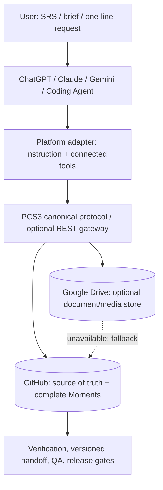

# PCS 3.0 — Kiến trúc kỹ thuật và bất biến

## Thiết kế 5 lớp

**Advanced Mode:** GitHub `pcs3/projects/<slug>/HEAD.json` là nguồn trạng thái. **Simple Mode (mặc định):** repository riêng của dự án có `pcs/STATE.json` (`pcs3.simple.v1` bao bọc cùng cấu trúc project state) là nguồn chính. Hai định dạng không được cập nhật song song nếu chưa migration. Google Drive không mang trạng thái hay quyết định cuối; chỉ chứa blobs bổ trợ có provenance và checksum; mỗi blob còn có bản sao trên GitHub để khôi phục kể cả khi Drive ngừng hoạt động. Không sử dụng chat history hay AI memory làm state chuẩn.

## Simple Mode (không cần backend trung tâm)

Xem [`SIMPLE_MODE.md`](SIMPLE_MODE.md). AI tự tạo repo private, quản lý Issues, `pcs/STATE.json` và `pcs/MOMENT.md`; dùng SHA GitHub Contents để phát hiện conflict. Git history lưu vết thay đổi, nhưng **không có mức bảo đảm append-only event CAS như Advanced Mode**.

## Advanced Mode canonical data

- `HEAD.json`: `{schema,project,revision,event_id,event_hash,state_hash,state,updated_at}`. Dữ liệu `state` gồm product_map, architecture_map, source_refs, tasks, features, flows, releases, decisions, risks, approvals, artifacts, current.
- `events/MOM-<date>-<uuid>.json`: bản sao **đầy đủ** của state; revision, actor, reason, at, previous_event, previous_hash, state_hash. Mỗi event có SHA-256 ổn định trên JSON sorted-key; có thể duyệt ngược từ HEAD tới genesis.
- `artifacts/<sha256>-<name>`: fallback binary nhỏ dưới 800kB trên Contents API. File lớn dùng GitHub draft Release asset, metadata nằm trong HEAD. Khi Drive được kết nối, sử dụng Drive Blob + bản sao toàn bộ ở GitHub + manifest.
- `source_refs` là bản ghi nguồn của SRS/đề cương, **chưa được hiểu hoặc duyệt**; agent phải tạo bản đồ yêu cầu bằng suy luận từ tài liệu thật.
- `approvals` lưu metadata; không thay thế xác minh danh tính/chữ ký của chủ dự án. Bản đồ trạng thái chỉ cập nhật khi có bằng chứng hợp lệ.

## Concurrency and exact handoff

1. Agent đọc HEAD: revision N và blob SHA do GitHub trả về.
2. Agent thực hiện thay đổi và lưu evidence.
3. `commit` ghi một event mới chứa đủ snapshot; sau đó ghi HEAD theo `sha` cũ (optimistic compare-and-swap).
4. Nếu HEAD đã thay đổi bởi agent khác, GitHub từ chối; agent phải reload và reconcile, tuyệt đối không force overwrite. Event đã upload mà HEAD thất bại trở thành **orphan**, cần audit/reconcile (được báo rõ, không coi thành công).
5. `verify` kiểm tra HEAD state hash + chuỗi event được HEAD trỏ tới. Không bảo vệ tuyệt đối trước người có quyền ghi toàn bộ repository rồi sửa cả HEAD và mọi event. Bắt buộc áp dụng protected branch, audit logs, backup và least privilege nếu cần bảo đảm cao.

## QA: bốn cấp hoàn thành

Task = phần việc; Feature = năng lực sản phẩm; Flow = luồng end-to-end; Release = gói phát hành. Cấp ACCEPTED yêu cầu evidence metadata có verification provenance và phê duyệt, cùng QA / Integration / E2E / Security+Rollback tương ứng. Chính sách QA có thể được điều chỉnh theo loại artifact nhưng việc sửa policy phải được review. CLI kiểm **hình thức metadata và hash**, không tự kiểm tra rằng một con người thật đã ký hay CI bên ngoài đã chạy.

## Dependency analysis

Agent định kỳ cập nhật Product Map/Architecture Map và các quan hệ task–feature–flow–release; test coverage ưu tiên các ranh giới API, dữ liệu, IAM, media, UX, releases. Tránh xây graph quá chi tiết hoặc bắt agent đọc mọi tài liệu trước mọi bước. Architecture map phải phân biệt `CURRENT_VERIFIED`, `TARGET_APPROVED`, `PROPOSED`.

## Recovery / migration

- Resume: GH HEAD → verify event chain → exact current next_action.
- Disaster recovery: export Git repository clone/backup + GitHub Release assets; Drive blob được ghi song song có GitHub mirror. `verify` kiểm tra lịch sử state; `verify --assets=true` tải và đối chiếu bytes từ bản GitHub (và `--drive=true` nếu cần). Không thay thế backup/branch protection.
- PCS 2.1: lưu trữ riêng tại `archive/PCS_2.1_LEGACY_ARCHIVE.zip` và dùng migration mapping; không import trạng thái DEMO như dữ liệu thật.

## Ranh giới quan trọng

Đây là reference code cho GitHub API và Google Drive API. Không có cloud server hay OAuth ứng dụng đã được cấu hình; cần người dùng kết nối/ủy quyền. Mọi bản nâng cấp provider phải kiểm tra lại docs và test thật trong sandbox. Không tự gọi hoạt động production.

## GitHub Inbox gatewayless mode

Chat apps có quyền tạo file GitHub nhưng không chạy Node/hash chain có thể gửi yêu cầu dưới `pcs3/inbox/REQ-*.json`. GitHub Actions (`templates/private-intake/pcs3-inbox.yml`) đọc yêu cầu, áp dụng có kiểm tra CAS, ghi receipt và Moment. Đây là tùy chọn **không cần host server** nhưng repo Actions + quyền ghi phải được cấu hình/kiểm thử một lần. Xem `GITHUB_INBOX_MODE.md`.

## Dynamic Agent Collaboration (giai đoạn 3.0.2+)

Đối với dự án sử dụng `pcs/STATE.json`, registry agent/lead/proposal/assignments nằm ở `state.collaboration`, không phải một state song song. `runtime/pcs3-agent-operator.mjs` có thể commit STATE + MOMENT + snapshot **trong một Git commit** với ref update không force, chống ghi đè do các agent thao tác đồng thời. Owner/Lead có hai nguồn quyền khác nhau: owner được xác minh qua GitHub repository metadata và comment, Lead phải có ủy quyền owner còn hạn. Mẫu này không thể xác minh nhiều agent nếu tất cả dùng cùng một GitHub principal; phải áp dụng tài khoản hoặc token riêng cùng branch protection cho môi trường có rủi ro. Xem [`AGENT_COLLABORATION.md`](AGENT_COLLABORATION.md).
